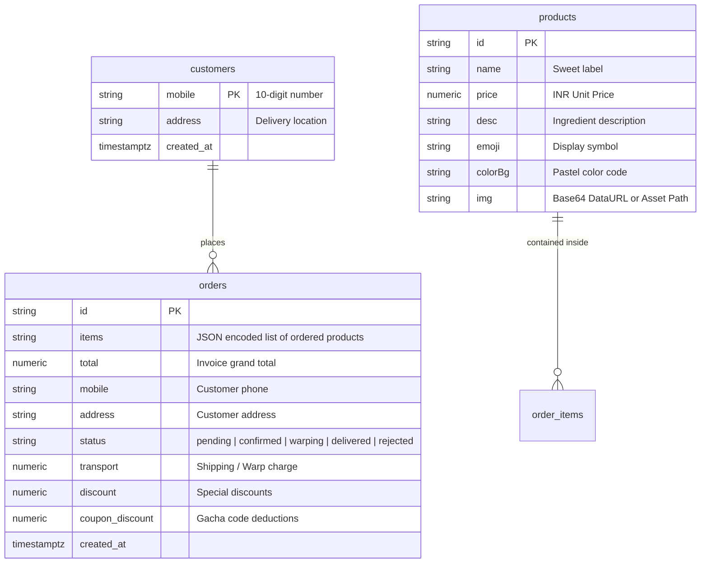
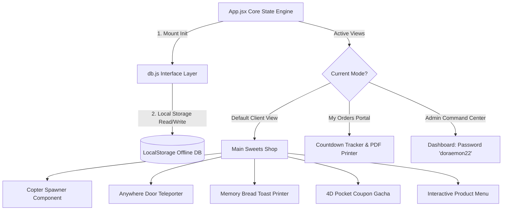

# 🛸 Pocket Sweets - 22nd-Century Dessert Platform Blueprint

Welcome to the official developer blueprint for **Pocket Sweets**, a premium, highly interactive Doraemon-themed dessert delivery application. This platform bridges the nostalgic 22nd-century magic of Doraemon's futuristic gadgets with a modern, high-fidelity customer pastry ordering experience.

---

## 🛠️ The Tech Stack

Pocket Sweets is engineered using a robust client-first modern web stack to ensure smooth animations, real-time database reactivity, and self-healing storage capability.

| Category | Technology | Purpose |
| :--- | :--- | :--- |
| **Core Framework** | **React 19.2 (ESModules)** | Powers the reactive state engine, modular component architecture, and responsive UI tree. |
| **Build & Tooling** | **Vite 8.0 + HMR** | Standard-setting dev server and blazing-fast packaging utility. |
| **Database Backend** | **Browser LocalStorage API** | High-performance, offline-first client storage handling complete CRUD persistence for products, orders, and customer accounts. |
| **Design & Styles** | **Vanilla CSS & Google Fonts** | Implements HSL color palettes, multi-dimensional themes (Meadow, Candy, Cosmic), and micro-animations. |
| **Audio Engine** | **Web Audio API** | Real-time audio synthesizer generating dynamic oscillator wave tones on micro-actions. |
| **Micro-FX** | **Canvas Confetti** | Multi-colored celebration physics triggering on items add/theme shifts/prize unlocks. |
| **Local Storage** | **LocalStorage Engine** | Resilient offline database fallback for products, orders, and customer accounts. |## 🗄️ Database Architecture & Schemas

The database layer runs on a **Pure Browser LocalStorage Backend**. The service layer [db.js](file:///d:/bk/Doraemon/src/services/db.js) persists and indexes all data locally inside the client's browser using standardized JSON keys, guaranteeing 100% offline uptime, zero network latency, and persistent CRUD operations across sessions.

### Storage Data Models (LocalStorage Collections)

The application organizes data across three primary localStorage collections (`dora_products`, `dora_customers`, and `dora_orders`):



### Collection Schema Definitions

#### 1. Products Collection (`dora_products`)
Stores the futuristic desserts offered on the menu (seeded with 4 default signature pastries upon first visit).
* `id` (String, Primary Key): Unique alphanumeric product ID.
* `name` (String): Name of the dessert.
* `price` (Number): Pastry price (formatted in ₹ INR).
* `desc` (String): Fun Doraemon-themed ingredient story.
* `emoji` (String): Descriptive emoji representation.
* `colorBg` (String): Background HEX value for product display cards.
* `img` (String, Nullable): Base64 Data URL or relative asset path for the pastry image.

#### 2. Customers Collection (`dora_customers`)
Tracks frictionlessly registered customer profiles mapped to mobile numbers.
* `mobile` (String, Primary Key): Unique 10-digit mobile number serving as the account ID.
* `address` (String): Saved delivery address.
* `created_at` (ISO String): Date the profile was initiated.

#### 3. Orders Collection (`dora_orders`)
Records all transactional orders routed through the portal.
* `id` (String, Primary Key): Alphanumeric transaction ID.
* `items` (String): JSON-stringified array containing purchased item records (`name`, `price`, `count`).
* `total` (Number): Grand total payable in INR.
* `mobile` (String): Phone contact of the ordering client.
* `address` (String): Warp destination address.
* `status` (String): Order pipeline progress state (`pending`, `confirmed`, `warping`, `delivered`, `rejected`).
* `transport` (Number): Shipping fee.
* `discount` (Number): Custom direct discounts assigned by admin.
* `coupon_discount` (Number): Amount deducted via 4D Pocket coupon.
* `created_at` (ISO String): Ordering timestamp.

---

## 🔄 Dynamic Core State Workflow

The application operates as a unified Single-Page App (SPA) coordinated by state triggers within [App.jsx](file:///d:/bk/Doraemon/src/App.jsx). 



### State Variables in `App.jsx`
1. `productsList`: Dynamic list of available menu items synchronized from the database.
2. `cartList`: Active shopping cart holding quantities of sweets.
3. `themeIndex`: Tracks the active environmental dimension portal.
4. `customBreadText`: Reactive string projected on the virtual Memory Bread slice.
5. `checkoutActive` & `modalActive`: Toggle flags for checkout flow and gadget gacha cards.
6. `adminMode` & `myOrdersMode`: Screen layout triggers allowing seamless dashboard warping.
7. `activePrize`: Active coupon code currently held by the user from the 4D Pocket.
8. `appLoading`: Simulates a 1.2s cosmic warp animation before showing the application to the customer.

---

## 🧱 Modular Architecture & Component Workflow

Pocket Sweets consists of highly polished, interactive modules. Here is a description of each component and how it functions:

### 1. The Dynamic Entry Loader ([CoolLoader.jsx](file:///d:/bk/Doraemon/src/components/CoolLoader.jsx))
* **Function**: Renders an immersive fullscreen warp portal when the application initializes.
* **Mechanism**: Displays a spinning, pulsing circular gate matching the active theme's colors. A 1.2-second delay gives the database sufficient time to fetch the menu items, preventing sudden content layout shifts.

### 2. Copter Spawner Badge ([CopterSpawner.jsx](file:///d:/bk/Doraemon/src/components/CopterSpawner.jsx))
* **Function**: Floating action trigger badge that spawns flying sweets on the screen.
* **Mechanism**: Clicking the floating badge (`🚁`) triggers a synthesized bubble chime. An internal loop fires 8 times, launching sweet emoji entities (`🍡`, `🥞`, `🍩`, etc.) at random horizontal positions (`left: vw`). These float upwards via CSS keyframe animations and are cleanly garbage-collected from the DOM using a 4.1s timeout.

### 3. Anywhere Door Dimension Teleporter ([AnywhereDoor.jsx](file:///d:/bk/Doraemon/src/components/AnywhereDoor.jsx))
* **Function**: Seamless multi-dimensional layout and background styling shifts.
* **Mechanism**: Renders a custom Anywhere Door graphic. Clicking the door triggers a spatial warp sound, opens the door visual, and applies specific CSS theme classes to `document.body` after a 400ms delay.
* **Dimensions Available**:
  1. `🌾 Dorayaki Meadow` (Default): Clean, bright pastel blue layout.
  2. `🍭 Candy Cloud World` (`theme-candy-cloud`): Sweet pastel pinks and soft borders.
  3. `🌌 Cosmic Gelato Orbit` (`theme-cosmic-gelato`): Sleek dark theme with neon cyan glow and starlight backdrops.

```css
/* Multi-Dimension Theme Base Styling */
body.theme-candy-cloud {
  --bg-primary: #fff0f5;
  --dora-blue: #ff69b4;
  --dora-blue-light: #ffe4e1;
  --text-dark: #8b008b;
}

body.theme-cosmic-gelato {
  --bg-primary: #0a0e17;
  --bg-secondary: #131b2e;
  --text-dark: #f1f5f9;
  --border-light: rgba(56, 189, 248, 0.2);
}
```

### 4. Memory Toast Printer ([ToastCustomizer.jsx](file:///d:/bk/Doraemon/src/components/ToastCustomizer.jsx))
* **Function**: Dynamic interactive math formula and note printing.
* **Mechanism**: Displays a text field prompting Nobita to enter equations or exam notes. As the user types, the react state updating `customBreadText` propagates text changes immediately into a textured bread visual with realistic crust borders, matching how the actual Memory Bread gadget works.

### 5. 4D Pocket Coupon Gacha ([FourDPocket.jsx](file:///d:/bk/Doraemon/src/components/FourDPocket.jsx) & [Modal.jsx](file:///d:/bk/Doraemon/src/components/Modal.jsx))
* **Function**: Interstellar portal that rewards users with active coupon tickets.
* **Mechanism**: Clicking the 4D Pocket widget starts a gacha draw. To maintain balance, it enforces a **7-day cooldown** limit per device or phone number.
* **Gadgets & Coupons Pool**:
  * **Memory Bread Coupon** (`MEMORY15`): 15% discount off the entire sweets ticket.
  * **Bamboo-Copter Deal** (`COPTERFREE`): Grants a free Cloud Mochi Cupcake on orders above ₹1000.
  * **Anywhere Door Delivery** (`ANYWHEREDELIVERY`): Waives dimension transport/shipping charges.
  * **Translation Jelly Treat** (`JELLY20`): Deducts 20% off all jelly and mochi orders.

### 6. Order Space Portal & Tracker ([MyOrders.jsx](file:///d:/bk/Doraemon/src/components/MyOrders.jsx))
* **Function**: Frictionless customer portal for tracking desserts, downloading invoices, and checking statuses.
* **Mechanism**: Entering a 10-digit phone number queries `getCustomerOrders` to fetch order history.
* **Live Status Timeline Engine**:
  * An interval polls the database every 5 seconds, pulling down order edits made by the administrator.
  * An active 1-second interval counts down remaining seconds until a telephonic callback.
  * Evaluates five key stages of order completion, updating a responsive visual progress bar:


* **Interactive Timeline Stages**:
  * **Stage 1 (Pending Call)**: Displays a 10-minute countdown while the shop manager gets ready to dial.
  * **Stage 2 (Dialing Now)**: If countdown runs out or time is imminent, a ringing phone emoji vibrates (`Incoming Call!`).
  * **Stage 3 (Baking sweets)**: Swaps to a golden theme after the manager verifies the order over the phone and updates the status to `confirmed`.
  * **Stage 4 (Warp Active)**: Triggered when status switches to `warping`. Renders dynamic spaceship portal animations.
  * **Stage 5 (Arrived)**: Highlighting green styling when status switches to `delivered`.

> [!TIP]
> **Tax Invoice PDF Generator**: Within the tracking sheet, customers can click a button that opens a popup window and compiles a clean, print-friendly, beautiful Tax Invoice utilizing custom fonts, table matrices, structural calculations, and standard browser `window.print()` triggers.

### 7. Checkout Controller ([CheckoutModal.jsx](file:///d:/bk/Doraemon/src/components/CheckoutModal.jsx))
* **Function**: Manages phone verification, address entry, coupon validation, and order routing.
* **Mechanism**: 
  * Entering a 10-digit number triggers an automatic lookup of the customer's saved address in the database, auto-filling the input field.
  * Validates and applies gadget coupon codes, automatically updating order subtotal calculations.
  * Prevents double-redemption by checking past transaction records.
  * Saves or updates client details in the `customers` database on form submission.

### 8. Administrator Command Center ([AdminDashboard.jsx](file:///d:/bk/Doraemon/src/components/AdminDashboard.jsx))
* **Function**: An advanced backdoor dashboard that gives administrative power over products, orders, and customer listings.
* **Access Control**: Protected by a password challenge requiring `'doraemon22'`.
* **Sub-Modules Available**:

#### A. Orders Management Tab
* **Interactive Filters**: Search orders instantly by phone number, filter by date, or isolate by progress status (`pending`, `confirmed`, `warping`, `delivered`, `rejected`).
* **Warp Status Transitions**: Instantly update orders along the verification pipeline with single-click actions (`Warp Order`, `Deliver Sweets`, `Reject Request`).
* **The Advanced Invoice Editor**: Allows the admin to modify items in active orders in real-time:
  * Adjust quantities of individual sweets.
  * Inject new sweets from the active catalog into the customer's current invoice.
  * Customize transport fees or direct discounts.
  * Re-calculate tax bills and write modifications back to the database.

#### B. Products Management Tab
* **Catalog CRUD Control**: Create new sweets or update/delete existing items.
* **Configuration Attributes**: Modify product ID, title, description, price, display emoji, and background colors.
* **Local Image Storage**: Encodes and stores uploaded product pictures as Base64 Data URLs directly within LocalStorage, providing instant offline persistence and rendering.

#### C. Customers Registry Tab
* **Active Directory**: View a list of registered customer accounts.
* **Global Search**: Search customers by phone or registered delivery address.
* **Wipe Profile logs**: Delete old customer accounts or clear faulty profile registers.

---

## 🎼 The Sound Synthesizer System

To ensure maximum immersion, Pocket Sweets bypasses external audio files (which can fail to load or slow down connections) and instead dynamically synthesizes audio in the browser via the **Web Audio API**.

Located inside [App.jsx](file:///d:/bk/Doraemon/src/App.jsx#L75-L127), the engine utilizes an `OscillatorNode` combined with an exponential `GainNode` volume ramp to produce two distinct sounds:

### 1. Bubble Chime Sound
Triggers when an item is added to the cart, a portal button is clicked, or standard dialogs close.
* **Wave Type**: `sine` (pure, bell-like tone).
* **Frequency Modulation**: Starts at 450Hz and exponentially sweeps upwards to 1100Hz in 120ms.
* **Gain Envelope**: Starts at 12% volume (`0.12`) and decays exponentially to `0.01` within the 120ms timeline.

### 2. Space Swoosh Teleport Sound
Triggers when pulling gadget tickets from the 4D Pocket or opening portals.
* **Wave Type**: `triangle` (warm, geometric synth tone).
* **Frequency Modulation**: Starts at a low 90Hz rumbling pitch and sweeps exponentially to a high 400Hz frequency in 250ms.
* **Gain Envelope**: Starts at 8% volume (`0.08`) and decays to virtual silence (`0.01`) in 250ms.

---

## 🔒 Security & Temporal Constraints

To ensure order safety and prevent coupon exploits, the application enforces the following rules:

1. **Gacha Limits**: Users can only retrieve coupons from the 4D Pocket once every 7 days.
2. **Phone Number Format**: All input fields require exactly 10 digits to prevent database formatting errors.
3. **Admin Protection**: The admin panel requires the password `doraemon22` to prevent unauthorized access.

---

### 🥞 Developer Note

Pocket Sweets is a showcase of how nostalgia and modern web technology can come together. Happy baking in the 22nd-century laboratory! 🚀🍰
